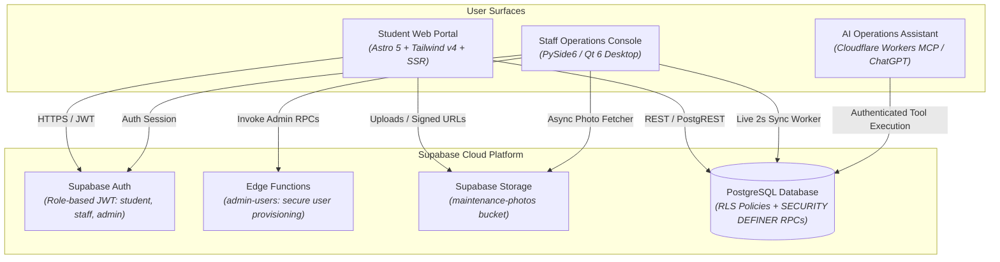

<div align="center">


# RÉSIVO: University Residence & Facility Management System

**Direction des Œuvres Universitaires • Cité Universitaire • Tlemcen**

[](https://astro.build)
[](https://tailwindcss.com)
[](https://www.qt.io/)
[](https://www.python.org/)
[](https://supabase.com)
[](https://www.typescriptlang.org/)
[](https://workers.cloudflare.com/)

<p align="center">
  A management platform for university student residences. It replaces paper dossiers with digital registration, verifies applicant matriculation numbers against official university rosters, enforces gender-segregated room capacity rules, and tracks maintenance tickets.
</p>

[Key capabilities](#key-capabilities) •
[System architecture](#system-architecture) •
[Quickstart](#quickstart-and-installation) •
[Security and privacy](#security-and-privacy-architecture) •
[Official roster dataset](#official-university-roster-dataset) •
[Testing](#automated-testing-and-verification)

---

</div>

## Overview

RÉSIVO (*Résidence Universitaire*) provides an operations system for university student housing across four components:

1. **Resident Web Portal (`web/`)**: responsive web application built with Astro 5 and Tailwind CSS v4. Enrolled students register with their university card ID, check housing approval status, access digital resident passes, report dormitory maintenance issues with photos, and submit room transfer requests.
2. **Staff Operations Console (`desktop/`)**: administrative desktop workstation built with Python 3.11 and PySide6 (Qt 6). Housing staff review pending applications, verify students against university rosters, assign room blocks, manage maintenance tickets with an asynchronous photo viewer, adjudicate room swaps, and configure staff accounts.
3. **AI Facility Assistant (`mcp-worker/` and `mcp/`)**: Model Context Protocol (MCP) server deployed to Cloudflare Workers. Enables authorized staff to query occupancy statistics, pending tickets, and dormitory status through ChatGPT or compatible MCP clients.
4. **Backend Infrastructure (`supabase/`)**: Supabase (PostgreSQL 15, Auth, Storage) configured with Row Level Security (RLS) policies, versioned migrations, and transactional PL/pgSQL stored procedures.

---

## System architecture



---

## Key capabilities

### Student resident web portal

- Academic verification: registration requires student card ID matching against official university records.
- Digital resident pass: displays assigned building block, room number, floor, and official resident pass.
- Maintenance triage: students submit issues by category with photos and descriptions, tracking status across Pending, In Progress, and Resolved stages.
- Room transfers: transfer requests include written justifications and enforce gender-segregated block matching.
- Access guards: unapproved or rejected accounts cannot file room requests until approved by staff.

### Staff operations console

- Background sync: 2-second background polling via `LiveSyncWorker` with unread badges and notifications.
- Application adjudication:
  - Filter by Pending Applications, Approved Residents, Rejected Applications, and All.
  - Desk inquiry reference: mandatory rejection notes displayed on applicant cards to answer in-person student questions.
  - Deletion guards: pending applications cannot be deleted until formally approved or rejected.
- Room and resident directories: live room occupancy tracking, block capacity visualization, and student profile inspection.
- Photo viewer: multi-threaded dialog (`PhotoViewerDialog`) with asynchronous image fetching and 25% to 400% zoom controls.
- Staff access controls: multi-tier account management preventing self-deletion across UI, Edge Functions, and database functions.
- Adaptive layout: interface scales from minimum desktop resolutions (980x640) up to 4K displays.

### AI Assistant (Model Context Protocol)

- Natural language queries: inspect occupancy numbers and open maintenance tickets.
- Access enforcement: read-only by default with audit trails; write operations require confirmation.

---

## Quickstart and installation

### Prerequisites

- Node.js: v22.12.0 or higher
- Python: 3.11 or higher
- Supabase CLI: `npx supabase`

---

### 1. Backend configuration (Supabase)

1. Clone the repository and create your local environment file:
   ```bash
   git clone https://github.com/anesdevv/residence-management-system.git
   cd residence-management-system
   cp .env.example .env
   ```

2. Configure `.env` with your project credentials:
   ```ini
   SUPABASE_URL=https://<your-project-id>.supabase.co
   SUPABASE_ANON_KEY=your-anon-key
   SUPABASE_SERVICE_ROLE_KEY=your-service-role-key
   ```

3. Link your Supabase project and push database migrations:
   ```bash
   npx supabase login
   npx supabase link --project-ref <your-project-id>
   npx supabase db push
   ```

4. Seed initial rooms and administrator accounts:
   ```bash
   python scripts/seed.py
   ```

---

### 2. Student web portal setup

```bash
cd web
npm install
npm run dev
```

The portal runs at `http://localhost:4321`.

---

### 3. Staff desktop console setup

1. Create and activate a Python virtual environment:
   ```bash
   # Windows PowerShell
   python -m venv desktop\.venv
   .\desktop\.venv\Scripts\Activate.ps1

   # Linux / macOS
   python3 -m venv desktop/.venv
   source desktop/.venv/bin/activate
   ```

2. Install desktop dependencies:
   ```bash
   pip install -r desktop/requirements.txt
   ```

3. Launch the staff console:
   ```bash
   python desktop/main.py
   ```

---

### 4. AI assistant MCP worker setup

```bash
cd mcp-worker
npm install
npx wrangler deploy
```

Connect the deployed worker URL (`https://<your-worker-subdomain>.workers.dev/mcp`) to ChatGPT or your preferred MCP client.

---

## Security and privacy architecture

| Layer | Mechanism | Protection |
|---|---|---|
| Database | Row Level Security (RLS) | Restricts students to their own rows; grants staff read and write access for housing operations. |
| Database | `SECURITY DEFINER` RPCs | Functions like `delete_student` and `delete_staff` enforce parameter checks and explicit search paths (`public, auth, pg_temp`). |
| Edge Functions | Bearer JWT & Service Role | `admin-users` function verifies admin claims before creating or revoking staff accounts. |
| Client UI | Multi-tier self-deletion guard | Prevents staff members from deleting their own active accounts across UI, Edge Function, and database tiers. |
| Audit trails | Rejection documentation | Enforces mandatory recorded explanations when applications are rejected. |
| Credentials | Environment variables | Configuration uses `.env.example` templates; secrets are not committed to source control. |

---

## Official university roster dataset

The repository includes student rosters formatted for the bulk import tool:

- [`official_students_roster.csv`](official_students_roster.csv) (Root directory)
- [`data/official_students_sample.csv`](data/official_students_sample.csv) (Data directory)

Specifications:
- Institution: Université Abou Bekr Belkaïd, Tlemcen
- Faculties: Technologie, Médecine, Sciences, Sciences Économiques, Droit, Lettres, SNV
- Student IDs: 40 matriculation numbers (`202437010001` through `202437010040`)
- Fields: `card_id`, `first_name`, `last_name`, `gender`, `birth_date`, `faculty`, `university`

---

## Design system

The design system specification is documented in [`docs/DESIGN.md`](docs/DESIGN.md):

- Color palette: WCAG AA-compliant tokens used across desktop (`desktop/app/ui/theme.py`) and web (`web/src/styles/tokens.css`).
- Icons: SVG icons based on Lucide conventions (`Icon.astro` and `icons.py`).
- Typography: Local OFL fonts (Outfit for headings and digital pass, Inter with tabular numbers for tables).
- Common component patterns: matching contracts across desktop and web (`StatusPill`, `Stepper`, `Card`, `PageHeader`, `InlineBanner`, `EmptyState`, `KeyValue`).
- Screenshots: interface captures stored in [`docs/screenshots/desktop/`](docs/screenshots/desktop/) and [`docs/screenshots/web/`](docs/screenshots/web/).

---

## Automated testing and verification

### Desktop test suite (PySide6 / Pytest)

```bash
# Run all 23 desktop unit and integration tests in offscreen mode
$env:QT_QPA_PLATFORM="offscreen"; desktop\.venv\Scripts\pytest.exe desktop\tests -v
```

Test coverage includes:
- `test_deletion_and_filters.py`: status filtering, mandatory rejection notes, live sync filter preservation, deletion restrictions, self-deletion defense
- `test_flexible_window.py`: minimum window dimensions, splitter limits, layout geometry
- `test_photo_viewer.py`: asynchronous image worker, zoom scaling, dialog termination
- `test_sign_out.py`: worker shutdown, session invalidation, window transitions
- `test_importer.py`: CSV and Excel roster parsing and validation
- `test_client.py`: API client connection and authentication

### Web test suite (Vitest)

```bash
cd web
npm test
```

---

## Repository structure

```text
residence-management-system/
├── data/                               # Sample datasets and rosters
│   └── official_students_sample.csv    # 40-record sample roster
├── desktop/                            # Staff Operations Console (PySide6 / Qt6)
│   ├── app/
│   │   ├── importers/                  # CSV/Excel roster importers
│   │   └── ui/
│   │       ├── pages/                  # Desktop views (Pending, Rooms, Maintenance)
│   │       ├── live_sync.py            # 2-second background polling worker
│   │       ├── photo_viewer.py         # Multi-threaded photo viewer dialog
│   │       └── theme.py                # High-contrast dark theme
│   ├── tests/                          # Automated unit and integration tests
│   ├── main.py                         # Desktop application entrypoint
│   └── requirements.txt                # Python dependencies
├── docs/                               # Architecture, logos, and specifications
│   ├── resivo_logo.svg                 # Vector brand mark
│   └── resivo_logo_transparent.png     # Transparent brand logo
├── mcp-worker/                         # Cloudflare Workers MCP server
├── mcp/                                # Local Python MCP server
├── scripts/                            # Database seed and maintenance scripts
├── supabase/                           # Database migrations, seed data, Edge Functions
│   ├── functions/admin-users/          # Edge Function for staff user management
│   └── migrations/                     # Version-controlled SQL migrations
├── web/                                # Student Resident Portal (Astro 5 + Tailwind v4)
│   ├── src/
│   │   ├── components/                 # Reusable UI components
│   │   ├── layouts/                    # Application shells
│   │   └── pages/                      # Web routes (Registration, Dashboard, Maintenance)
│   └── package.json                    # Node.js dependencies and scripts
├── official_students_roster.csv        # Production import roster
└── README.md                           # Project documentation
```

---

## License and attribution

Developed for the Direction des Œuvres Universitaires (DOU), Cité Universitaire, Tlemcen.  
Licensed under the [MIT License](LICENSE).
