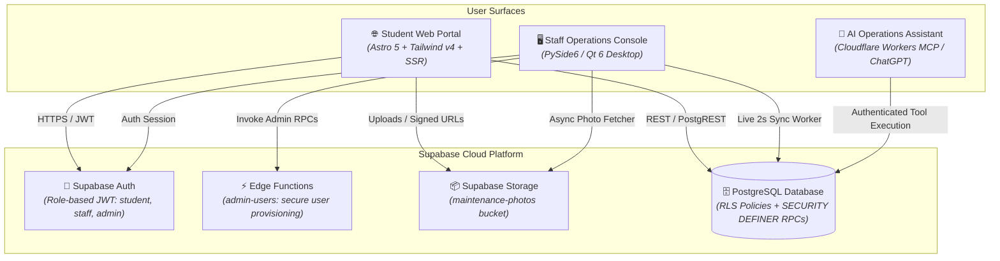

<div align="center">


# RÉSIVO

### University Residence & Facility Management System
**Direction des Œuvres Universitaires • Cité Universitaire • Tlemcen**

[](https://astro.build)
[](https://tailwindcss.com)
[](https://www.qt.io/)
[](https://www.python.org/)
[](https://supabase.com)
[](https://www.typescriptlang.org/)
[](https://workers.cloudflare.com/)

<p align="center">
  A secure, modern, multi-surface accommodation and facility operations platform designed for university student residences. Eliminates manual paper dossiers, accelerates maintenance triage, enforces gender-segregated room capacity rules, and cross-references registrations against official university enrollment rosters.
</p>

[Key Capabilities](#-key-capabilities) •
[System Architecture](#-system-architecture) •
[Quickstart](#-quickstart--installation) •
[Security & Privacy](#-security--privacy-architecture) •
[Official Roster Dataset](#-official-university-roster-dataset) •
[Testing](#-automated-testing--verification)

---

</div>

## 📌 Overview

**RÉSIVO** (*Résidence Universitaire*) provides an integrated operations ecosystem tailored for higher-education student housing:

1. **Resident Web Portal (`web/`)**: Mobile-first, responsive web application built with **Astro 5** and **Tailwind CSS v4**. Enrolled students register with their university card ID, view housing approval status, access digital resident passes, report dormitory maintenance issues with photo attachments, and request room transfers.
2. **Staff Operations Console (`desktop/`)**: High-contrast, dense administrative workstation built with **Python 3.11** and **PySide6 (Qt 6)**. Housing officers review pending dossiers, verify students against university rosters, assign room blocks, manage facility tickets with an asynchronous photo viewer, adjudicate room swaps, and configure staff accounts.
3. **AI Facility Assistant (`mcp-worker/` & `mcp/`)**: **Model Context Protocol (MCP)** server deployed to Cloudflare Workers. Allows authorized administrators to query occupancy statistics, pending tickets, and dormitory status directly through ChatGPT or any compatible MCP client.
4. **Backend Infrastructure (`supabase/`)**: **Supabase** (PostgreSQL 15, Auth, Storage) featuring fine-grained Row Level Security (RLS) policies, idempotent migrations, and transactional PL/pgSQL stored procedures.

---

## 🏛️ System Architecture



---

## 🌟 Key Capabilities

### 🌐 Student Resident Web Portal
- **Academic Verification**: Enforce enrollment matching against official university card IDs upon registration.
- **Digital Resident Pass**: View assigned dormitory block, room number, floor, and official residency pass.
- **Maintenance Triage**: File maintenance faults with category selection, description, and photo attachments; track progress through a 4-stage lifecycle (`Submitted` → `Under Review` → `In Progress` → `Resolved`).
- **Room Transfers**: Submit room transfer justifications with gender-segregated block matching.
- **Safety Locks**: Inactive and rejected applicants are prevented from filing room requests until administrative approval.

### 🖥️ Staff Operations Console
- **Live Background Sync**: 2-second background polling (`LiveSyncWorker`) with unread badge counters and toast notifications.
- **Application Adjudication**:
  - Filter across `Pending Applications`, `Approved Residents`, `Rejected Applications`, and `All`.
  - **Desk Inquiry Reference**: Rejection reasons are mandatory and displayed prominently in applicant inspector cards for answering desk inquiries.
  - **Safe Deletion Guards**: Pending applications cannot be deleted until approved or rejected.
- **Room & Resident Directories**: Real-time room occupancy tracking, block capacity visualization, and instant student profile inspections.
- **High-Resolution Photo Viewer**: Dedicated multi-threaded photo viewer dialog (`PhotoViewerDialog`) with asynchronous fetching and 25%–400% zoom controls.
- **Staff Access Control**: Multi-tier protected staff management with strict self-deletion prevention across UI, Edge Functions, and database RPCs.
- **Flexible UI Layout**: Resilient layout supporting minimum resolutions (980×640) up to 4K displays without crushed controls.

### 🤖 AI Assistant (Model Context Protocol)
- **Natural Language Inquiries**: Query dormitory metrics ("*How many rooms are available in Block B?*", "*List open plumbing tickets*").
- **Admin Role Enforcement**: Read-only by default with audit trails; administrative mutations require explicit user confirmation.

---

## 🚀 Quickstart & Installation

### Prerequisites
- **Node.js**: `v22.12.0` or higher
- **Python**: `3.11` or higher
- **Supabase CLI**: `npx supabase`

---

### 1. Backend Configuration (Supabase)

1. Clone repository and initialize environment variables:
   ```bash
   git clone https://github.com/anesdevv/residence-management-system.git
   cd residence-management-system
   cp .env.example .env
   ```

2. Configure `.env` with your project credentials (never commit real credentials):
   ```ini
   SUPABASE_URL=https://<your-project-id>.supabase.co
   SUPABASE_ANON_KEY=your-anon-key
   SUPABASE_SERVICE_ROLE_KEY=your-service-role-key
   ```

3. Link your Supabase project and push database migrations:
   ```bash
   npx supabase login
   npx supabase link --project-ref <your-project-id>
   npx supabase db push
   ```

4. Seed initial dormitory rooms and administrator accounts:
   ```bash
   python scripts/seed.py
   ```

---

### 2. Student Web Portal Setup

```bash
cd web
npm install
npm run dev
```
The student portal is available at `http://localhost:4321`.

---

### 3. Staff Desktop Console Setup

1. Create and activate a Python virtual environment:
   ```bash
   # Windows PowerShell
   python -m venv desktop\.venv
   .\desktop\.venv\Scripts\Activate.ps1

   # Linux / macOS
   python3 -m venv desktop/.venv
   source desktop/.venv/bin/activate
   ```

2. Install desktop dependencies:
   ```bash
   pip install -r desktop/requirements.txt
   ```

3. Launch the Staff Console:
   ```bash
   python desktop/main.py
   ```

---

### 4. AI Assistant MCP Worker Setup

```bash
cd mcp-worker
npm install
npx wrangler deploy
```
Connect the deployed worker URL (`https://<your-worker-subdomain>.workers.dev/mcp`) to ChatGPT Plus/Pro or your preferred MCP client.

---

## 🔒 Security & Privacy Architecture

Security and privacy are enforced at every tier of the application stack:

| Layer | Mechanism | Protection |
| :--- | :--- | :--- |
| **Database** | Row Level Security (RLS) | Restricts students to their own records; grants staff read/write on housing operations. |
| **Database** | `SECURITY DEFINER` RPCs | Operations like `delete_student` and `delete_staff` enforce parameter checks and search paths (`public, auth, pg_temp`). |
| **Edge Functions** | Bearer JWT & Service Role | `admin-users` function validates admin claims before creating or revoking staff credentials. |
| **Client UI** | Multi-Tier Self-Deletion Guard | Prevents staff officers from deleting their own administrative accounts across UI, Edge Function, and PostgreSQL levels. |
| **Audit Trails** | Rejection Documentation | Requires formal reasons upon application rejection for transparency during administrative desk inquiries. |
| **Credentials** | Zero Plaintext Secrets | No secrets, private tokens, or database passwords are hardcoded in the codebase; configuration uses template `.env.example` files. |

---

## 📋 Official University Roster Dataset

The repository includes pre-built student rosters formatted for the **Official List** bulk import feature:

- [`official_students_roster.csv`](official_students_roster.csv) *(Root directory)*
- [`data/official_students_sample.csv`](data/official_students_sample.csv) *(Data directory)*

**Dataset Specifications:**
- **Institution**: Université Abou Bekr Belkaïd - Tlemcen
- **Faculties**: 7 Academic faculties (*Technologie, Médecine, Sciences, Sciences Économiques, Droit, Lettres, SNV*)
- **Student IDs**: 40 standard matriculation numbers (`202437010001` through `202437010040`)
- **Fields**: `card_id`, `first_name`, `last_name`, `gender`, `birth_date`, `faculty`, `university`

---

## 🧪 Automated Testing & Verification

The codebase includes automated test suites across both desktop and web clients:

### Desktop Test Suite (PySide6 / Pytest)
```bash
# Run all 19 desktop unit and integration tests
desktop\.venv\Scripts\pytest.exe desktop\tests -v
```
**Test Coverage Includes:**
- `test_deletion_and_filters.py`: Status filtering, mandatory rejection reasons, live sync filter preservation, deletion restrictions, self-deletion defense.
- `test_flexible_window.py`: Minimum window size enforcement, stretch behavior, responsive geometry.
- `test_photo_viewer.py`: Async photo loading worker, zoom scaling, dialog termination.
- `test_sign_out.py`: Background worker shutdown, session invalidation, window transitions.
- `test_importer.py`: Official roster CSV/Excel parsing and validation.

### Web Test Suite (Vitest)
```bash
cd web
npm test
```

---

## 📁 Repository Structure

```text
residence-management-system/
├── data/                               # Sample datasets and rosters
│   └── official_students_sample.csv    # 40-record sample roster
├── desktop/                            # Staff Operations Console (PySide6 / Qt6)
│   ├── app/
│   │   ├── importers/                  # CSV/Excel roster importers
│   │   └── ui/
│   │       ├── pages/                  # Desktop views (Pending, Rooms, Maintenance, etc.)
│   │       ├── live_sync.py            # 2s background polling worker
│   │       ├── photo_viewer.py         # Multi-threaded photo viewer dialog
│   │       └── theme.py                # Institutional high-contrast dark theme
│   ├── tests/                          # 19 automated desktop unit/integration tests
│   ├── main.py                         # Desktop application entrypoint
│   └── requirements.txt                # Python dependencies
├── docs/                               # Architecture, logos, and specifications
│   ├── resivo_logo.svg                 # Vector brand mark
│   └── resivo_logo_transparent.png     # Transparent brand logo
├── mcp-worker/                         # Cloudflare Workers MCP server (ChatGPT assistant)
├── mcp/                                # Local Python MCP fallback server
├── scripts/                            # Database seed and maintenance scripts
├── supabase/                           # Database migrations, seed data, and Edge Functions
│   ├── functions/admin-users/          # Edge Function for staff user management
│   └── migrations/                     # Version-controlled SQL migrations
├── web/                                # Student Resident Portal (Astro 5 + Tailwind v4)
│   ├── src/
│   │   ├── components/                 # Reusable UI components
│   │   ├── layouts/                    # Application shells
│   │   └── pages/                      # Web routes (Registration, Dashboard, Maintenance)
│   └── package.json                    # Node.js dependencies and scripts
├── official_students_roster.csv        # Production-ready import roster
└── README.md                           # Project documentation
```

---

## 📄 License & Attribution

Developed for **Cité Universitaire — Direction des Œuvres Universitaires (DOU)**.  
Licensed under the [MIT License](LICENSE).
