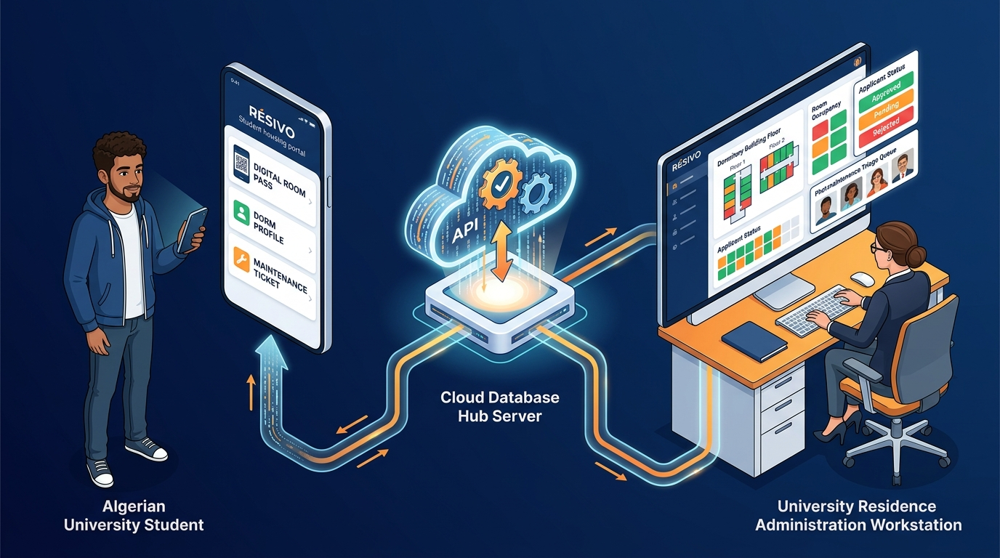
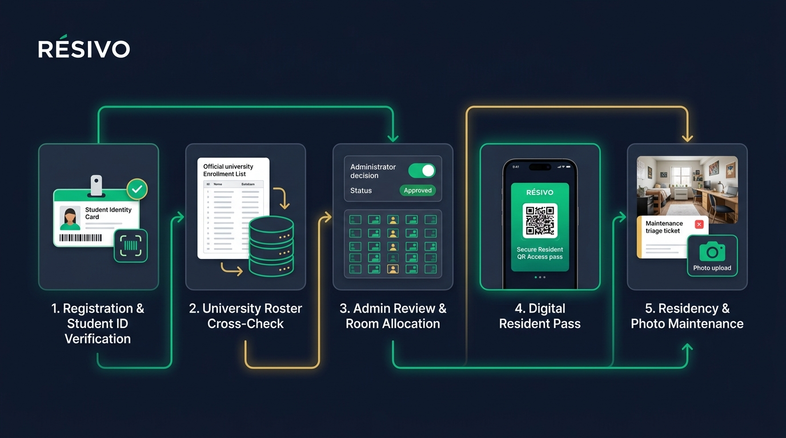
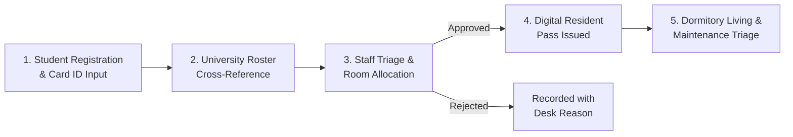
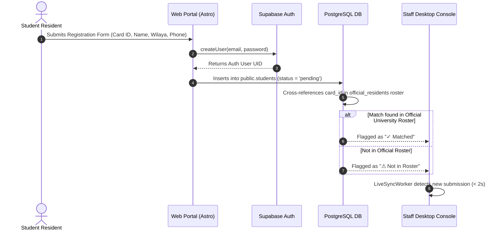
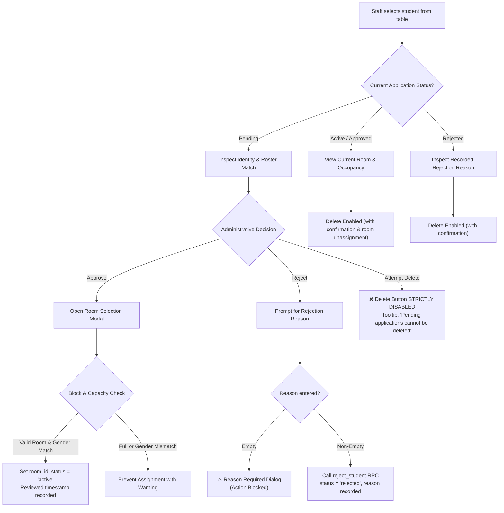
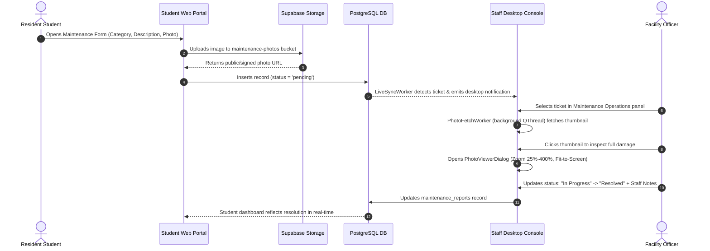
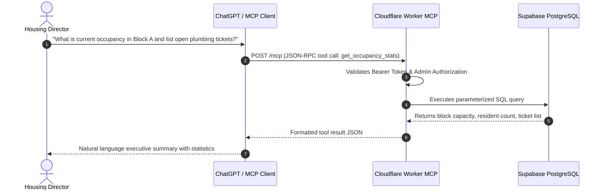

# RÉSIVO — Application Flow & Architecture Document

**System:** RÉSIVO (*Système de Gestion de Résidence Universitaire*)  
**Institutional Authority:** Direction des Œuvres Universitaires (DOU) • Cité Universitaire • Tlemcen  
**Document Version:** 1.0.0 (Production-Ready)  
**Date:** October 2026  

---

## 1. System Ecosystem & Dual-Surface Overview

RÉSIVO unites two primary operational surfaces supported by an AI assistant layer and a shared PostgreSQL database infrastructure:



1. **Resident Web Portal (`web/`)**: Accessible on mobile phones, tablets, and personal computers. Designed with a mobile-first, low-friction paradigm for student residents.
2. **Staff Operations Console (`desktop/`)**: Dedicated PySide6 (Qt 6) desktop workstation application running continuously in dormitory administration offices. Designed for rapid triage, density, and 2-second live background synchronization.
3. **AI Operations Assistant (`mcp-worker/`)**: Cloudflare Workers server exposing Model Context Protocol (MCP) endpoints for natural language operations by housing directors via ChatGPT.

---

## 2. End-to-End Residency Lifecycle

The diagram below outlines the five chronological phases through which every resident transitions:



### Stage-by-Stage Operational Sequence



---

## 3. Detailed Application Flows & Logic Trees

### Flow 1: Student Registration & Enrollment Verification



---

### Flow 2: Housing Application Adjudication & Decision Tree

Administrative desk officers process student dossiers using the **Student Applications & Housing** console (`PendingPage`). The decision flow strictly enforces institutional safeguards:



#### Desk Inquiry Support Feature:
When a rejected applicant comes to the front desk, the officer selects the student in the `Rejected Applications` tab. The detail card instantly displays:

```text
⚠️ REJECTION REASON (Desk Inquiry Reference):
"Incomplete academic file: missing residence registration slip"
Reviewed: 2026-10-12 14:30
```

---

### Flow 3: Facility Maintenance Reporting & Visual Triage



---

### Flow 4: Room Transfer Adjudication Flow

```mermaid
flowchart TD
    R_Start["Active Resident applies for Room Change"] --> R_Lock{"Is student status active?"}
    R_Lock -->|No (Pending/Rejected)| R_Deny["Form Locked: Transfer requests restricted to active residents"]
    R_Lock -->|Yes| R_Submit["Selects Target Room & Submits Motive"]
    
    R_Submit --> Staff_Queue["Request appears in Room Transfer Applications"]
    Staff_Queue --> Staff_Decision{"Housing Officer Adjudication"}
    
    Staff_Decision -->|Approve| AutoSwap["Update student room_id = target_room_id<br/>Update request status = 'approved'<br/>Recalculate block occupancy"]
    Staff_Decision -->|Reject| EnterMotive["Prompt for rejection justification<br/>Call reject_room_change RPC"]
    Staff_Decision -->|Delete| ConfirmDel["Confirm & Delete from room_change_requests"]
```

---

### Flow 5: Staff Accounts & Multi-Tier Self-Deletion Safeguard

```mermaid
flowchart TD
    Admin["Admin selects account in Staff Accounts"] --> CheckID{"Selected ID == Current Logged-in Admin UID?"}
    
    CheckID -->|YES (Self Selected)| Tier1["UI Layer: delete_btn.setEnabled(False)<br/>Tooltip: 'You cannot delete your own staff account'"]
    Tier1 --> Tier2["Client Handler: on_delete() aborts if ID matches"]
    
    CheckID -->|NO (Other Staff Member)| EnableDel["delete_btn.setEnabled(True)"]
    EnableDel --> ClickDel["Admin clicks Delete & confirms dialog"]
    ClickDel --> EdgeFn["Invoke admin-users Edge Function (action: delete_staff)"]
    
    EdgeFn --> EdgeCheck{"Edge Check: target_id == caller.uid?"}
    EdgeCheck -->|Self| EdgeErr["Return HTTP 400 'cannot delete yourself'"]
    EdgeCheck -->|Valid| CascadeDelete["1. Delete public.staff record<br/>2. Delete public.profiles record<br/>3. Delete auth.users account"]
    
    CascadeDelete --> SQL_RPC["Fallback RPC delete_staff enforces: if p_staff = auth.uid() RAISE EXCEPTION"]
```

---

### Flow 6: Model Context Protocol (MCP) AI Query Flow



---

## 4. State Transition Matrix

| Entity | Current State | Allowed Transitions | Trigger / Condition |
| :--- | :--- | :--- | :--- |
| **Student** | `pending` | `active` | Staff approves and allocates a room with available capacity matching student gender. |
| **Student** | `pending` | `rejected` | Staff rejects application with mandatory written justification. |
| **Student** | `pending` | *Deletion Blocked* | **Strictly Prohibited**: Pending applications cannot be deleted. |
| **Student** | `active` | `deleted` | Staff permanently removes record; unassigns room and cascades dependencies. |
| **Student** | `rejected` | `active` | Staff re-evaluates and approves previously rejected dossier. |
| **Student** | `rejected` | `deleted` | Staff permanently prunes rejected applicant record. |
| **Maintenance** | `pending` | `in_progress` | Facility technician begins triage/repair work. |
| **Maintenance** | `in_progress`| `resolved` | Repair completed; resolution notes documented. |
| **Room Change**| `pending` | `approved` | Transfer room confirmed; student room pointer updated atomically. |
| **Room Change**| `pending` | `rejected` | Transfer denied; refusal justification recorded. |

---

## 5. Error & Exception Handling Paths

| Scenario | System Defense / Handling Path | User Experience |
| :--- | :--- | :--- |
| **Missing from University Roster** | Cross-reference flag returns negative match. | Desktop displays red `⚠ Not in Roster` badge; alerts officer to request physical enrollment certificate before approval. |
| **Room at Maximum Capacity** | Allocation modal calculates `occupants >= capacity`. | Room row styled with full indicator; allocation button disabled for that room. |
| **Gender Mismatch in Allocation** | Student gender compared with Dormitory Block gender rule. | Allocation modal displays warning; blocks assignment to opposite-gender block. |
| **Live Sync Network Interruption** | Background `LiveSyncWorker` wraps polling in `try/except`. | Worker remains alive; retries on next 2000ms tick without crashing desktop application. |
| **Desktop Window Resize** | Minimum geometry pinned to 980×640; panels use flexible min/max stretch rules. | Layout remains clean across all monitor sizes from laptop displays to 4K monitors without crushed controls. |
