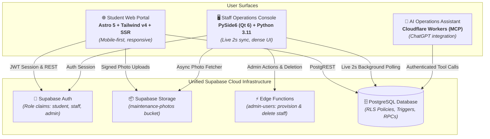
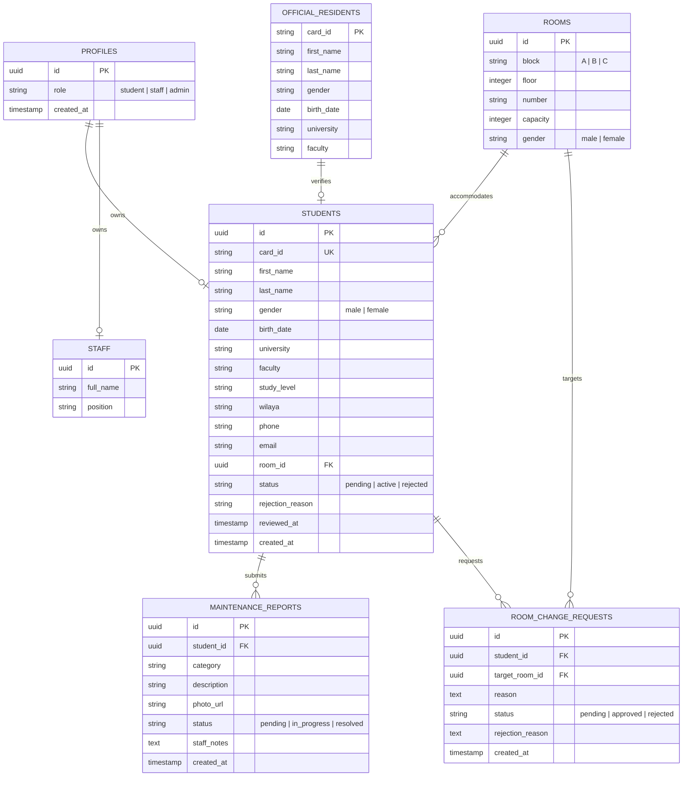

# Product Requirements Document (PRD)

**Project Name:** RÉSIVO (*Système de Gestion de Résidence Universitaire*)  
**Institutional Authority:** Direction des Œuvres Universitaires (DOU) • Cité Universitaire • Tlemcen  
**Document Version:** 1.0.0 (Production-Ready)  
**Date:** October 2026  
**Document Status:** Approved & Implemented  
**Target Environments:** Web Portal (Students) & Desktop Workstation Console (Housing Staff)

---

## 1. Executive Summary & Vision

### 1.1 Problem Statement
Historically, university student residence operations (housing application intake, room assignments, physical enrollment verification, facility maintenance reporting, and room transfer approvals) have relied on manual paper dossiers, physical bulletin boards, and in-person administration desk inquiries. This resulted in:
- Long student queues at dormitory administration offices at the beginning of academic semesters.
- Discrepancies between physical room occupancy and central enrollment records.
- Delayed maintenance triage with no structured tracking or visual evidence of damage.
- Lost or undocumented justifications when students were rejected, leaving desk officers unable to explain rejections during inquiries.
- Unmonitored staff changes and accidental data loss.

### 1.2 Vision & Core Objective
**RÉSIVO** is an end-to-end, multi-surface student residence and facility management platform tailored for Algerian higher-education campuses. It provides:
1. **A friction-free, mobile-accessible resident web portal** for students to apply, verify card IDs, check approval status, access digital resident passes, report maintenance faults with photos, and request transfers.
2. **A high-density, real-time desktop operations console** for dormitory staff to process hundreds of applications daily, automatically match applicants against official university rosters, triage maintenance reports with high-resolution photo viewers, and safely prune obsolete records.
3. **An AI operations assistant via Model Context Protocol (MCP)** allowing authorized housing directors to query room capacity, ticket queues, and resident rosters in natural language through ChatGPT or custom MCP clients.

---

## 2. Stakeholders & User Personas

| Persona | Surface | Primary Motivations | Pain Points Addressed |
| :--- | :--- | :--- | :--- |
| **Student Resident** *(e.g., Undergraduate / Master Student)* | Web Portal *(Mobile / Laptop)* | Quick application submission, transparent status tracking, quick maintenance reporting, digital residency pass. | Eliminates standing in line for hours; provides instant mobile feedback on housing status and maintenance resolution. |
| **Housing Intake Officer** *(Intake & Registration Desk)* | Desktop Console *(Workstation)* | Fast application scanning, cross-checking enrollment against official university rosters, rapid room allocation. | Automates identity verification; eliminates paper rosters; flags unverified applicants immediately. |
| **Facility Maintenance Officer** *(Dormitory Maintenance)* | Desktop Console *(Workstation)* | Immediate damage triage, inspecting submitted fault photos, updating ticket stages. | High-resolution photo inspection eliminates unnecessary preliminary inspection trips to student rooms. |
| **Front Desk Inquiry Officer** *(Student Relations)* | Desktop Console *(Workstation)* | Answering in-person student queries when an application was rejected. | Mandatory `rejection_reason` displays prominently in applicant cards, providing clear documentation on missing papers. |
| **Residence Director** *(Administration)* | Desktop & MCP AI Assistant | Real-time occupancy oversight, audit trails, staff credential management, natural-language executive queries. | Real-time KPI visibility, self-deletion safeguards, and instant answers via ChatGPT integration. |

---

## 3. System Architecture & Dual-Surface Ecosystem



---

## 4. Functional Requirements (FR)

### Module 1: Student Application & Roster Verification
- **FR-1.1 Student Registration**: Students register with official university Card ID (`card_id`), Full Name, Gender, Birth Date, Wilaya of origin, Faculty, Academic Study Level, Phone, Email, and Password.
- **FR-1.2 Identity Verification**: The system cross-references the student's `card_id` against the `official_residents` roster table.
  - Matches display a `✓ Matched` emerald badge.
  - Missing records display a `⚠ Not in Roster` rose warning badge.
- **FR-1.3 Digital Resident Pass**: Approved residents receive a digital pass card displaying their assigned Dormitory Block, Floor, Room Number, and registration barcode.

### Module 2: Housing Application Adjudication (`PendingPage`)
- **FR-2.1 Multi-State Filtering Toolbar**: Staff can filter applications via 4 dedicated view modes:
  - `Pending Applications` *(default view)*
  - `Approved Residents` *(active residents)*
  - `Rejected Applications` *(rejected applicants)*
  - `All Applications` *(global table view)*
- **FR-2.2 Real-Time Search**: Search bar filters displayed records by Card ID, Name, or University in real-time.
- **FR-2.3 Room Allocation Modal**: Staff assign approved applicants to available rooms; capacity limits and gender segregation (Block A = Male, Block B = Female) are strictly validated.
- **FR-2.4 Mandatory Rejection Note**:
  - Rejecting an applicant requires a non-empty administrative justification.
  - The reason is saved to `students.rejection_reason` and review timestamp to `students.reviewed_at`.
- **FR-2.5 Desk Inquiry Reference Card**:
  - The detail inspector highlights the rejection reason:
    ```text
    ⚠️ REJECTION REASON (Desk Inquiry Reference):
    "<Recorded justification>"
    Reviewed: YYYY-MM-DD HH:MM
    ```
- **FR-2.6 Conditional Record Deletion**:
  - **Pending Applications**: Deletion is strictly **disabled** (`delete_btn.setEnabled(False)`) with tooltip: *"Pending applications cannot be deleted. Please approve or reject first."*
  - **Approved & Rejected Students**: Deletion is **enabled**. Clicking triggers a confirmation prompt, unassigns any room, and cascades student records via `delete_student` RPC.

### Module 3: Maintenance Ticketing & Visual Triage (`MaintenancePage`)
- **FR-3.1 Resident Submission**: Students submit tickets with category (`Plumbing`, `Electricity`, `Carpentry`, `Heating`, `General`), text description, and photo attachments.
- **FR-3.2 Three-Stage Lifecycle Tracking**: Both web and desktop track tickets through `Pending` → `In Progress` → `Resolved`.
- **FR-3.3 Asynchronous Photo Viewer**:
  - Clicking a ticket thumbnail opens `PhotoViewerDialog`.
  - Photos are fetched asynchronously via a dedicated `QThread` (`PhotoFetchWorker`), preventing UI freezing.
  - Controls include Fit-to-Window, Zoom In, Zoom Out (25%–400%), and Close.
- **FR-3.4 Ticket Deletion**: Staff can permanently remove obsolete or duplicate tickets with confirmation.

### Module 4: Room Transfer Adjudication (`RoomChangesPage`)
- **FR-4.1 Resident Transfer Requests**: Active residents can file room change requests with detailed motive and target room selection.
- **FR-4.2 Access Locks**: Students with `pending` or `rejected` status are locked out from filing transfer requests.
- **FR-4.3 Staff Adjudication**: Housing officers can approve transfers (automatically updating room assignments and occupancy) or reject with motive.
- **FR-4.4 Request Deletion**: Confirmed deletion of processed transfer requests.

### Module 5: Staff Administration & Access Control (`StaffAccountsPage`)
- **FR-5.1 Account Provisioning**: Admins create staff credentials (email, temporary password, full name, position) through the `admin-users` Edge Function.
- **FR-5.2 Multi-Tier Self-Deletion Prevention**:
  - **UI Tier**: Selecting the logged-in administrator disables the delete button with tooltip: *"You cannot delete your own staff account."*
  - **Client Handler Tier**: `on_delete()` guards against `staff["id"] == current_uid`.
  - **Edge Function Tier**: Rejects self-deletion requests with HTTP 400.
  - **Database RPC Tier**: `delete_staff` checks `if p_staff = auth.uid()` and raises an exception.
- **FR-5.3 Clean Cascading**: Deleting a staff account cleanly removes records from `public.staff`, `public.profiles`, and `auth.users`.

### Module 6: Live Background Synchronization (`LiveSyncWorker`)
- **FR-6.1 Polling Cadence**: Desktop console runs an asynchronous background thread polling every 2000ms.
- **FR-6.2 State Preservation**: The intake handler uses differential key comparison (`old_keys == new_keys`) to avoid unnecessary redraws, ensuring active filters and search terms are not wiped out.
- **FR-6.3 Live Toast Alerts**: Desktop status bar displays high-priority events (e.g., *"🔔 LIVE EVENT: New registration: Sarah Saidi"*).

### Module 7: Official University Roster Import (`OfficialListPage`)
- **FR-7.1 File Format Support**: Imports CSV and Excel (`.xlsx`) files.
- **FR-7.2 Schema Normalization**: Normalizes French and English headers (`Matricule`, `Nom`, `Prénom`, `Genre`, `Faculté`, `Date de Naissance`).
- **FR-7.3 Pre-Packaged Algerian Dataset**: Includes 40 realistic student records for *Université Abou Bekr Belkaïd - Tlemcen*.

### Module 8: AI Operations Assistant (Model Context Protocol)
- **FR-8.1 ChatGPT Integration**: Natural language interface hosted on Cloudflare Workers (`mcp-worker/`).
- **FR-8.2 Read-Only by Default**: Queries metrics and status without modifying database records unless explicitly confirmed by an administrator.

---

## 5. Non-Functional Requirements (NFR)

### 5.1 Performance & Responsiveness
- **Desktop UI Responsiveness**: Zero main-thread blocking during network operations or photo downloads (`QThread` workers for sync, health check, and photo fetching).
- **Desktop Geometry**: Responsive layout adapting smoothly between minimum resolution (980×640) and 4K monitors. Splitters maintain minimum panel widths (min 340px / max 480px).
- **Web Portal Core Web Vitals**: Sub-second Largest Contentful Paint (LCP) on mobile 4G networks; lightweight asset bundles via Astro static build and Tailwind CSS v4.

### 5.2 Security & Data Protection
- **Zero Plaintext Secrets**: No secrets, passwords, or production URLs stored in version control; templates provided via `.env.example`.
- **Row Level Security (RLS)**: Enforced across all tables (`students`, `rooms`, `maintenance_reports`, `room_change_requests`, `profiles`, `staff`).
- **Idempotency**: All SQL migrations use safe `drop policy if exists` guards.
- **RPC Hardening**: All stored procedures use `SECURITY DEFINER` with fixed search paths (`set search_path = public, auth, pg_temp`).

### 5.3 Reliability & Resilience
- **Clean Worker Termination**: Closing windows or signing out invokes `_shutdown_workers()` with bounded waits (3000ms wait / 1000ms terminate fallback) to prevent dangling threads or crashes.
- **Network Fault Tolerance**: Database connection drops fail gracefully without crashing UI views.

---

## 6. Data Model & Schema Specification



---

## 7. Verification & Quality Gates

| Verification Area | Tools / Harness | Gate Criteria | Status |
| :--- | :--- | :--- | :--- |
| **Desktop Unit & Integration** | Pytest 8.3.3 (`desktop/tests`) | 19 / 19 tests passing (`test_deletion_and_filters.py`, `test_flexible_window.py`, `test_photo_viewer.py`, `test_sign_out.py`, `test_importer.py`) | ✅ PASS |
| **Web Portal Tests** | Vitest 5.0.3 (`web/`) | Form validation, SSR rendering, auth redirects | ✅ PASS |
| **Backend Migrations** | Supabase CLI & MCP SQL runner | Idempotent execution, RLS policy verification, RPC test calls | ✅ PASS |
| **Edge Function Deployment** | Supabase Edge Runtime | `admin-users` version 3 active with self-deletion tests | ✅ PASS |
| **Roster File Parsing** | Importer parser | 40/40 sample records verified with date parsing and encoding | ✅ PASS |

---

## 8. Success Metrics & KPIs

1. **Intake Processing Speed**: Reduce per-student registration and room allocation time from ~25 minutes (manual paperwork) to < 60 seconds.
2. **Desk Inquiry Resolution**: 100% of rejected student inquiries answered immediately at the reception desk via recorded `rejection_reason`.
3. **Room Occupancy Accuracy**: 0% phantom resident allocations through strict capacity constraints and foreign-key cascades.
4. **Maintenance Turnaround**: Fault triage turnaround time reduced by >50% due to photo-verified preliminary evaluations.
5. **Data Protection Integrity**: Zero data leakage; zero self-deletion accidents by administrators.
